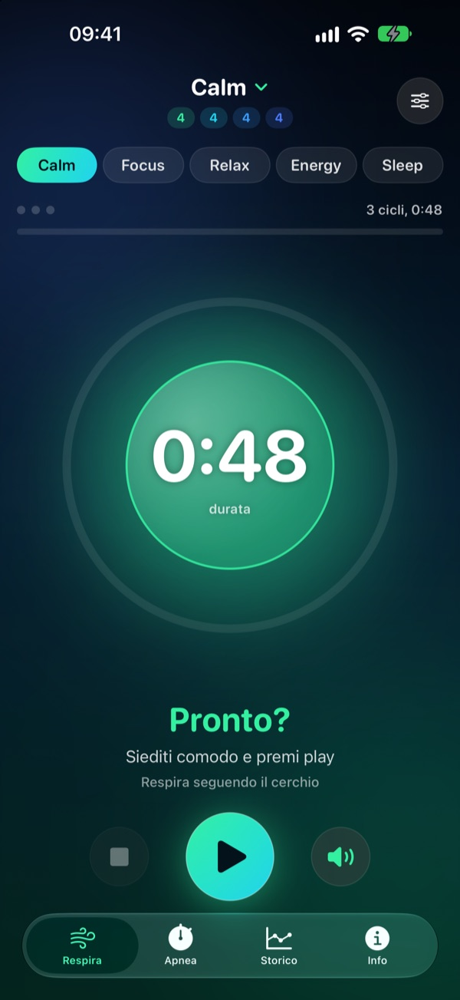
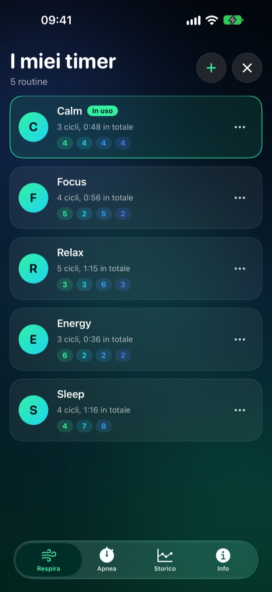
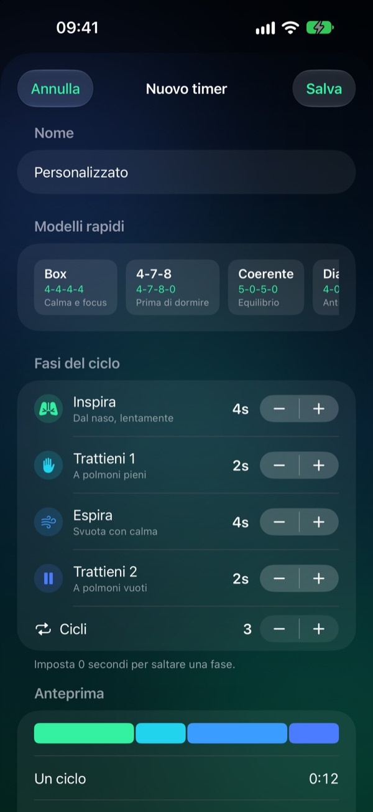
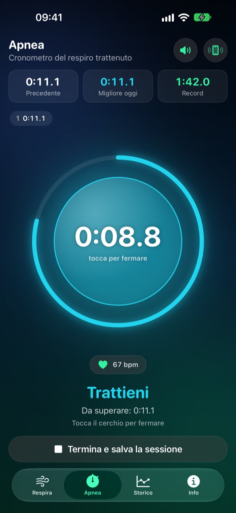
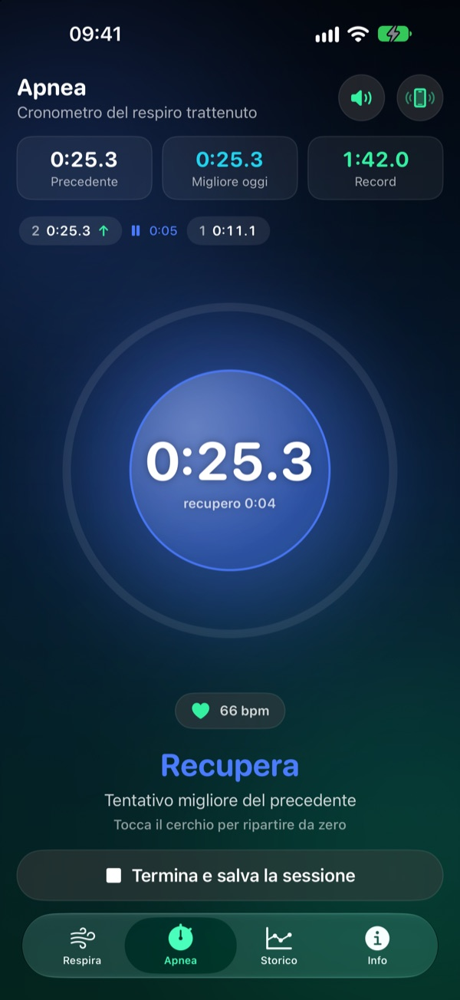
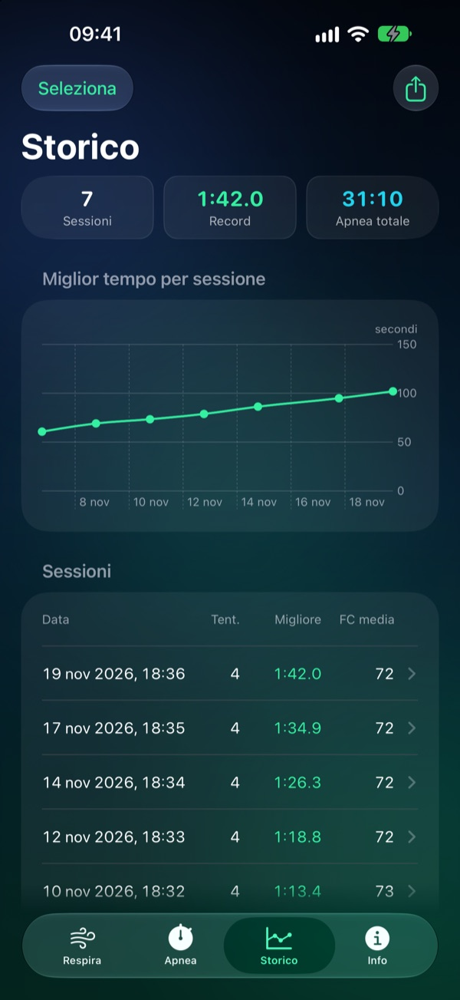
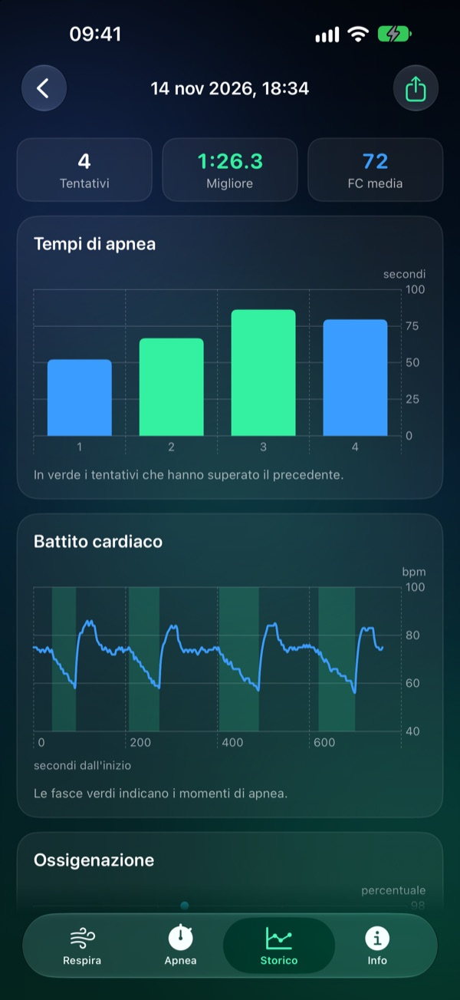
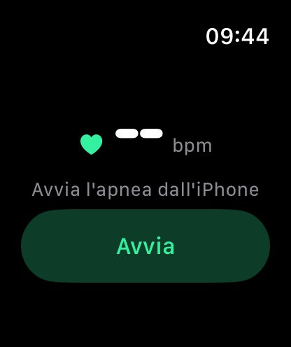
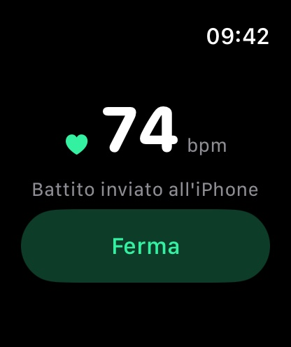

# Let's Breathe

App per iPhone e Apple Watch per esercizi di respirazione guidata e allenamento dell'apnea statica a secco, con battito cardiaco in tempo reale da Apple Watch.

<p align="center">
  
  
  
  
  
  
  
</p>

<p align="center">
  
  
</p>

> [!WARNING]
> **Mai in acqua, mai da soli.** Trattenere il respiro può far perdere conoscenza senza preavviso. L'app è pensata solo per allenamenti a secco, da seduti o sdraiati, con qualcuno vicino. Non è un dispositivo medico: i valori di battito e ossigenazione hanno solo finalità di benessere personale.

## Funzionalità

### Respira
- Timer di respirazione a quattro fasi: inspira, trattieni, espira, trattieni.
- Cinque timer già pronti: **Calm**, **Focus**, **Relax**, **Energy**, **Sleep**.
- Modelli rapidi per creare nuovi timer: **Box**, **4-7-8**, **Coerente**, **Diaframmatico**, **Triangolo**.
- Timer personalizzati: durata di ogni fase (0–60 s) e numero di cicli (1–30).
- Cerchio animato che segue il respiro, conto alla rovescia iniziale, pausa e ripresa.
- Suoni generati in tempo reale (tono e frequenza regolabili), beep a ogni secondo e vibrazione al cambio fase, tutti attivabili singolarmente.

### Apnea
- Cronometro a un tocco: un tocco avvia, uno ferma, il successivo inizia un nuovo tentativo nella stessa sessione.
- Tempo di recupero tra un tentativo e l'altro.
- Segnale sonoro e/o vibrazione quando superi il tentativo precedente.
- Il tempo resta preciso anche se l'app va in secondo piano.

### Apple Watch
- All'inizio di una sessione di apnea, l'iPhone apre automaticamente l'app sull'orologio.
- Il Watch avvia una sessione di allenamento per tenere acceso il sensore e invia il battito all'iPhone in tempo reale.
- A fine sessione l'allenamento viene scartato: non compare in Fitness né in Salute.
- Le letture di ossigenazione (SpO₂) registrate dall'orologio durante la sessione vengono lette da Salute.

### Storico
- Elenco delle sessioni con tentativi, tempo migliore, battito minimo, medio e massimo e SpO₂ minima per ogni tentativo.
- Grafici: andamento del tempo migliore nel tempo, durata di ogni tentativo, battito e SpO₂ durante la sessione.
- Esportazione in **CSV** (salvataggio in File o invio per email). Il separatore si adatta alle impostazioni del telefono, così il file si apre correttamente in Excel e Numbers.

### Altro
- Interfaccia in **italiano** e **inglese**, selezionabile dall'app (anche il Watch segue la lingua scelta).
- Avvertenze di sicurezza da accettare al primo avvio.
- Supporto a VoiceOver.

## Privacy

Tutti i dati restano sul dispositivo. L'app non ha un server, non invia nulla in rete, non usa pubblicità né strumenti di analisi e non richiede un account. I dati di Salute vengono solo letti, mai modificati, ed escono dal dispositivo solo quando li esporti tu.

## Requisiti

| | Versione minima |
|---|---|
| iPhone | iOS 18.5 |
| Apple Watch | watchOS 26.0 (facoltativo) |
| Sviluppo | Xcode 27, Swift 5 con concorrenza Swift attiva |

Il battito in tempo reale richiede un Apple Watch abbinato. La SpO₂ richiede un modello con sensore di ossigenazione e la funzione disponibile nel tuo Paese.

## Compilare il progetto

1. Clona il repository e apri `LetsBreathe.xcodeproj` in Xcode.
2. In **Signing & Capabilities** imposta il tuo team per i target **LetsBreathe** e **LetsBreathe Watch App**. Se cambi il bundle identifier dell'app iPhone, aggiorna anche:
   - il bundle identifier dell'app Watch, che deve iniziare con quello dell'iPhone (es. `tuo.id.app.watchkitapp`);
   - `WKCompanionAppBundleIdentifier` nelle impostazioni di build del target Watch.
3. Entrambi i target usano la capability **HealthKit**.
4. Avvia lo schema **LetsBreathe** su iPhone. L'app Watch è incorporata nell'app iPhone e si installa insieme a lei.

Per installare l'app direttamente sul Watch usa lo schema **LetsBreathe Watch App** con l'orologio come destinazione. La prima volta Xcode registra il Watch nel tuo account sviluppatore: deve essere sbloccato, con la Modalità sviluppatore attiva.

## Struttura

```
LetsBreathe/                App iPhone
  ContentView.swift           Schede, splash e consenso iniziale
  BreathingScreen.swift       Timer di respirazione, profili, audio e aptica
  ApneaScreen.swift           Cronometro di apnea
  HistoryScreen.swift         Storico, grafici ed esportazione
  ApneaData.swift             Modello dati, salvataggio ed esportazione CSV
  VitalsMonitor.swift         Collegamento con Apple Watch e lettura da Salute
  AboutScreen.swift           Informazioni, avvertenze e testi legali
  Localization.swift          Lingua dell'app (italiano / inglese)
LetsBreathe Watch App/      App Apple Watch
  WatchApp.swift              Sessione di allenamento e invio del battito
```

## Autore

Sviluppata da **Matteo Negri**. Per segnalazioni e suggerimenti scrivi a [silentmat@proton.me](mailto:silentmat@proton.me).

## Licenza

Distribuito con licenza MIT. Vedi il file [LICENSE](LICENSE).
